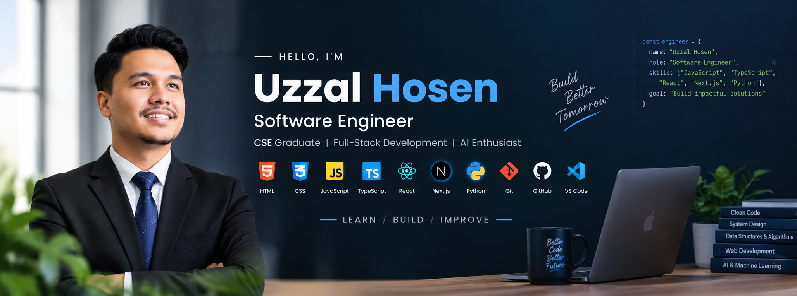

<div align="center">



</div>

<br />

# Hi, I'm Uzzal Hosen 👋

### Full-Stack WebDeveloper | CSE Graduate | Full-Stack Development & AI Enthusiast

<p>
  <a href="https://github.com/uzzal6090">
    
  </a>
  <a href="https://www.linkedin.com/in/uzzal-hosen-b9ba12395/">
    
  </a>
  <a href="mailto:hsoenuzzal769@gmail.com">
    
  </a>
</p>

</div>

---

## 👨‍💻 About Me
I’m a Computer Science and Engineering graduate and aspiring Software Engineer focused on building practical, user-friendly web applications.

I’m currently developing my skills in full-stack web development, working with JavaScript, TypeScript, React, Next.js, Node.js, Express.js, MongoDB, and Tailwind CSS. I enjoy learning software development fundamentals and applying what I learn by building real-world projects.

**My current focus areas include:**
- Frontend development with React, Next.js, and TypeScript
- Backend development with Node.js, Express.js, and REST APIs
- Database management with MongoDB
- Authentication and backend security fundamentals using JWT
- Version control and collaboration using Git and GitHub
- Problem-solving, debugging, and software engineering best practices

I believe the best way to grow as a software developer is through building projects, solving problems, debugging code, and continuously improving my technical skills.

I’m currently open to opportunities as a **Junior Software Engineer, Junior Full-Stack Developer, or Frontend Developer**, where I can contribute to a team, learn from experienced engineers, and grow as a software developer.

**Tech I’m working with:**
JavaScript | TypeScript | React | Next.js | Node.js | Express.js | MongoDB | REST APIs | JWT | HTML5 | CSS3 | Tailwind CSS | Git | GitHub
---

# 🧰 Tech Stack

## 💻 Programming Languages

<p>
  
</p>

* JavaScript (ES6+)
* TypeScript
* Python
* C++

---

## 🌐 Web Technologies

<p>
  
</p>

* HTML5
* CSS3
* Responsive Web Design
* REST API Integration
* Modern JavaScript

---

## ⚛️ Frameworks & Libraries

<p>
  
</p>

* React.js
* Next.js
* Tailwind CSS
* React Router
* React-based application development

---

## 🗄️ Databases

<p>
  
</p>

* MySQL
* MongoDB
* SQL
* Database Fundamentals
* CRUD Operations

---

## 🧠 Computer Science & Software Engineering

* Data Structures & Algorithms
* Object-Oriented Programming
* Problem Solving
* Programming Fundamentals
* Software Engineering Fundamentals
* Database Fundamentals
* API & Client-Server Architecture
* Clean & Maintainable Code
* Version Control
* Debugging & Troubleshooting

---

## 🛠️ Development Tools

<p>
  
</p>

* Git
* GitHub
* Visual Studio Code
* Postman
* npm
* Figma
* Chrome DevTools

---

## 🤖 AI & Modern Technologies

* AI Tools
* AI Prompting
* AI-assisted Development
* AI-powered Application Concepts
* Exploring Artificial Intelligence
* Exploring Machine Learning

---

# 🚀 Featured Projects

 # 📰 Bangla News 24

 Live link:https://bangla-news-24-two.vercel.app/


# Technologies Used
Frontend
Next.js
React
TypeScript
Tailwind CSS
HTML5
CSS3
# Backend & Authentication
Better Auth
MongoDB
MongoDB Adapter for Better Auth
API--


---

## 🧑‍💻 DevStack
Live link: https://dev-stack-psi.vercel.app/
A technology-focused web application that allows users to explore different technologies and build their preferred development stack.

**Tech Stack:**
`React` `TypeScript` `Tailwind CSS` `Vite`

---

## 🌐 Personal Portfolio

A personal portfolio website showcasing my skills, projects, learning journey, and development experience.
Live link: https://my-portfolio-project-beta-umber.vercel.app/

---

# 📖 Currently Learning

```text
Software Engineering
        │
        ├── Programming Fundamentals
        │
        ├── Data Structures & Algorithms
        │
        ├── Object-Oriented Programming
        │
        ├── JavaScript & TypeScript
        │
        ├── React & Next.js
        │
        ├── Full-Stack Development
        │
        ├── Databases & APIs
        │
        └── AI-Powered Applications
```

### Current Focus

* Building real-world software projects
* Improving JavaScript & TypeScript
* Learning advanced React concepts
* Learning Next.js and modern web architecture
* Strengthening Data Structures & Algorithms
* Improving problem-solving skills
* Learning backend and full-stack development
* Understanding software engineering practices
* Exploring AI-powered applications

---

# 🎯 Career Vision

My goal is to grow into a **strong and well-rounded Software Engineer** who can understand problems, design solutions, write maintainable code, and build reliable software applications.

I want to continuously improve my:

* Programming skills
* Problem-solving ability
* Software engineering mindset
* System design understanding
* Full-stack development skills
* Knowledge of modern technologies

Ultimately, I aim to combine **software engineering and AI** to build useful, scalable, and intelligent applications.

---

# 📊 GitHub Statistics

<div align="center">


</div>

---

# 📈 GitHub Activity

<div align="center">


</div>

---

# 🤝 Let's Connect

I am always interested in learning, collaborating, and working on interesting software projects.

<div align="center">

<a href="https://github.com/uzzal6090">
  
</a>

<a href="https://www.linkedin.com/in/uzzal-hosen-b9ba12395/">
  
</a>

<a href="mailto:hsoenuzzal769@gmail.com">
  
</a>

</div>

---

<div align="center">

### 💡 Build. Learn. Solve. Improve.

⭐ Thanks for visiting my profile!

</div>
