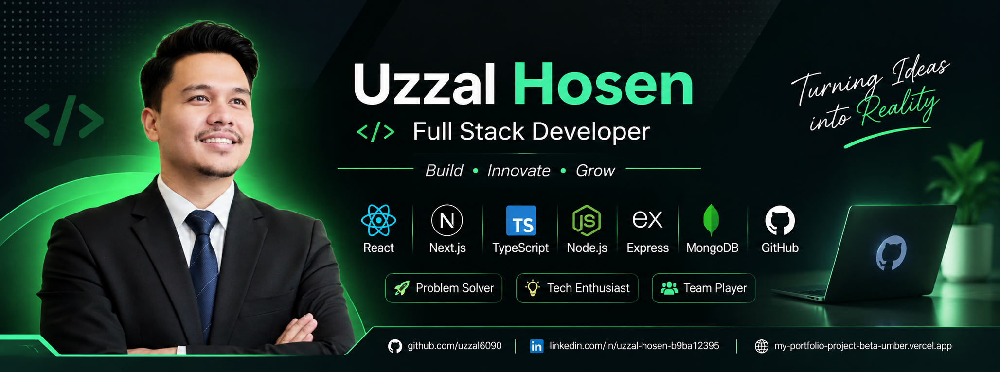

 <div align="center">
  
</div>

<br />

<h1 align="center">Hi, I'm Uzzal Hosen 👋</h1>

<h3 align="center">Full-Stack Web Developer | CSE Graduate | Software Engineering & AI Enthusiast</h3>

<p align="center">
  <a href="https://github.com/uzzal6090">
    
  </a>
  <a href="https://my-portfolio-project-beta-umber.vercel.app/">
    
  </a>
  <a href="https://www.linkedin.com/in/uzzal-hosen-b9ba12395/">
    
  </a>
  <a href="mailto:hosenuzzal769@gmail.com">
    
  </a>
</p>

---

## 👨‍💻 About Me

I'm a Computer Science and Engineering graduate passionate about building practical, scalable, and user-friendly web applications.

I focus on full-stack web development and enjoy turning ideas into functional software through clean code, problem-solving, and continuous learning.

Currently, I'm working with modern JavaScript technologies and strengthening my knowledge of software engineering, backend development, and AI-powered applications.

### 🎯 What I'm Focused On

- Building responsive and interactive web applications.
- Developing frontend applications using React and Next.js.
- Creating RESTful APIs with Node.js and Express.js.
- Working with MongoDB and database operations.
- Implementing authentication and authorization using JWT.
- Improving problem-solving and software engineering fundamentals.
- Exploring Artificial Intelligence and AI-powered applications.

### 💡 My Development Philosophy

I believe in learning by building. Every project gives me an opportunity to improve my coding skills, understand real-world problems, and become a better software developer.

**Currently open to:** Junior Software Engineer | Junior Full-Stack Developer | Frontend Developer opportunities.

---

## 🛠️ Technical Skills

### 💻 Programming Languages

<p>
  
</p>

- JavaScript (ES6+)
- TypeScript
- Python
- C++

### 🌐 Frontend Development

<p>
  
</p>

- HTML5 & CSS3
- React.js
- Next.js
- Tailwind CSS
- Responsive Web Design
- React Router
- REST API Integration

### ⚙️ Backend Development

<p>
  
</p>

- Node.js
- Express.js
- RESTful API Development
- Authentication & Authorization
- JWT
- Better Auth

### 🗄️ Database Management

<p>
  
</p>

- MongoDB
- MySQL
- CRUD Operations
- Database Fundamentals

### 🔧 Tools & Technologies

<p>
  
</p>

- Git & GitHub
- Visual Studio Code
- Postman
- Figma
- npm
- Chrome DevTools

### 🧠 Computer Science Fundamentals

- Data Structures & Algorithms
- Object-Oriented Programming
- Database Management
- Problem Solving
- Client-Server Architecture
- Debugging & Troubleshooting
- Software Engineering Fundamentals

### 🤖 AI & Emerging Technologies

- AI-assisted Development
- AI Prompt Engineering
- AI-powered Application Concepts
- Exploring Artificial Intelligence
- Exploring Machine Learning

---

## 🚀 Featured Projects

### 1. 🌍 The Human Collective

A social development events platform designed to help people discover, create, and participate in community-service activities.

**Technologies:** Next.js, TypeScript, Tailwind CSS

- [Live Demo](https://the-human-collective-client.vercel.app/)
- [Client Repository](https://github.com/uzzal6090/the-human-collective-client)
- [Server Repository](https://github.com/uzzal6090/the-human-collective-server)

### 2. 📰 Bangla News 24

A web-based news application built with modern frontend technologies and authentication integration.

**Technologies:** Next.js, React, TypeScript, Tailwind CSS, Better Auth, MongoDB

- [Live Demo](https://bangla-news-24-two.vercel.app/)
- [Source Code](https://github.com/uzzal6090/bangla-news-24)

### 3. 🛒 Bazar-Dor

A web development project built to strengthen my full-stack development skills through practical application development.

**Technologies:** Next.js, MongoDB, Better Auth

- [Live Demo](https://bazar-dor-indol.vercel.app/)
- [Source Code](https://github.com/uzzal6090/bazar-dor)

### 4. 💪 Fit Log

A fitness-focused web application developed as part of my practical full-stack development journey.

**Technologies:** Next.js, TypeScript

- [Live Demo](https://fit-log-olive.vercel.app/)
- [Source Code](https://github.com/uzzal6090/fit-log)

### 5. 💻 Dev Stack

A technology-focused web application that allows users to explore different technologies and build their preferred development stack.

**Technologies:** React, TypeScript, Tailwind CSS, Vite

- [Live Demo](https://dev-stack-psi.vercel.app/)

---

## 📚 Currently Learning

I'm continuously improving my software development knowledge and exploring modern technologies.

```text
Software Engineering
        |
        ├── Programming Fundamentals
        ├── Data Structures & Algorithms
        ├── Object-Oriented Programming
        ├── JavaScript & TypeScript
        ├── React & Next.js
        ├── Node.js & Express.js
        ├── Databases & REST APIs
        ├── Authentication & Security
        └── AI-powered Applications
```

### My Current Goals

- Build more real-world full-stack applications.
- Master advanced JavaScript and TypeScript concepts.
- Improve React and Next.js architecture knowledge.
- Strengthen backend development skills.
- Improve Data Structures & Algorithms.
- Learn software design principles and best practices.
- Explore AI integration in modern applications.

---

## 📊 GitHub Statistics

<div align="center">


</div>

## 🔥 GitHub Streak

<div align="center">


</div>

## 📈 GitHub Contribution Activity

<div align="center">


</div>

---

## 🎯 Career Vision

My long-term goal is to become a skilled Software Engineer capable of designing, developing, and maintaining reliable and scalable applications.

I'm particularly interested in combining **Full-Stack Software Development and Artificial Intelligence** to build meaningful solutions that solve real-world problems.

I value continuous learning, collaboration, clean code, and practical experience.

---

## 🤝 Let's Connect

I'm always interested in connecting with developers, learning new technologies, collaborating on projects, and exploring exciting opportunities.

<p align="center">
  <a href="https://github.com/uzzal6090">
    
  </a>
  <a href="https://www.linkedin.com/in/uzzal-hosen-b9ba12395/">
    
  </a>
  <a href="https://my-portfolio-project-beta-umber.vercel.app/">
    
  </a>
  <a href="mailto:hosenuzzal769@gmail.com">
    
  </a>
</p>

---

<div align="center">

### 💡 Build. Learn. Solve. Improve.

**Thanks for visiting my GitHub profile!** ⭐

</div>
